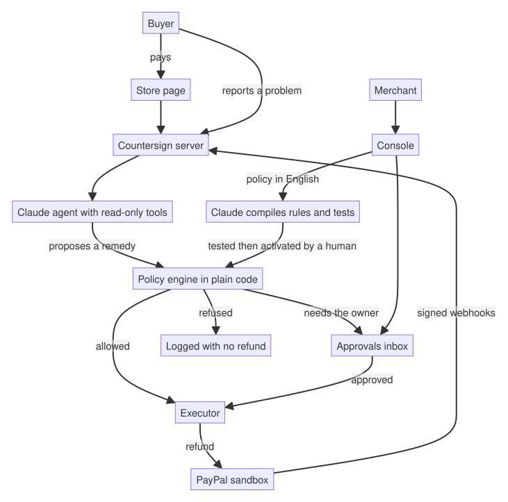

# Countersign

A refund agent for PayPal merchants.

Countersign helps a small shop handle refund requests. A buyer reports a problem, an AI agent looks into it and suggests what to do, and plain code decides whether any money moves and how much. The AI can propose a remedy, but it has no way to issue a refund itself.

It runs entirely on PayPal's sandbox, so no real money is involved. Built for the PayPal AI Hackathon.

- PayPal APIs used: OAuth 2.0, Orders v2 (create and capture), Payments v2 (refunds, with `PayPal-Request-Id`), webhook signature verification, and the JavaScript SDK v6 for checkout.
- Where the AI is: Claude Opus 5.5 turns a refund policy written in English into rules and test cases. Claude Sonnet 5.5 reads a buyer's claim and proposes a claim type and a remedy tier.
- Where it isn't: deciding whether to refund, how much, spending caps, retries and idempotency. That is ordinary code with tests.
- Live demo: https://countersign-k5f1.onrender.com (store at `/`, merchant console at `/admin.html`)

## Try it

Test accounts (sandbox only, no real money):

- Console, read-only judge token: `69a60ba070fb3dcc82a19d2a6f48bb8fcc66528de591fd381e9335f88cb47ef6`
- Sandbox buyer for checkout: `sb-u6v9p53832827@personal.example.com` / `5eB9%ySN`

1. Open the store page and click the PayPal button. Log in with the sandbox buyer above and pay for the mug.
2. Under "Something wrong with your order?", report a problem, for example "my mug arrived broken". Give it 30 to 45 seconds.
3. Open the Merchant console (the link at the top of the store page, or `/admin.html`) and paste the token. Open the case in the Cases tab to see what the agent looked at, what it proposed, what the rule engine decided and why, and the refund.
4. File a few more claims. Everyone who uses these test accounts shares one buyer, so after a few automatic refunds a per-buyer limit kicks in and later claims wait in the Approvals tab. The judge token is read-only, so you can look at those but not approve them.
5. The Policy tab shows the active policy and how it was understood. Writing and activating a new policy needs the admin token, so it isn't available with the judge token.

The first request after a quiet period can take 30 to 60 seconds while the free hosting wakes up.

## How it works



The idea is that the model proposes and the code decides. In practice that means:

- The agent only has read-only tools and a single "propose a remedy" call. Only the executor talks to PayPal's refund API.
- A proposal has no amount field. The agent sees opaque handles like `h_1` instead of real PayPal ids, and a proposal that cites a handle it was never given is rejected.
- The engine reloads the facts itself (order, earlier refunds, the buyer's history) and never reads the model's reasoning.
- A refusal rule beats a "needs the owner" rule, which beats an "allow" rule. If no rule matches, a person decides. Missing information counts against automatic approval.
- Before refunding, the executor takes a database lock, re-checks every limit, and reserves the amount. That keeps the limits intact when several claims arrive at once.
- Each refund carries an idempotency key. After a timeout, a retry reuses the key, so a buyer can't be paid twice.
- An approval is tied to a hash of the exact refund and the policy version. It expires after 48 hours and works once. A person can't approve something a refusal rule forbids.
- Webhooks are verified with PayPal and deduplicated by event id. Money is stored as integer cents.

## Tests and evaluation

There are 152 offline tests and 60 integration tests that run against a real Postgres (races, timeouts, replays, expiry). CI runs the offline set.

There is also a 30-scenario evaluation that uses the real Claude agent: ordinary claims, prompt injections, split-refund sequences and ambiguous claims. Each scenario was run twice. In all 60 runs, no refund went beyond what the written policy allows. "Allowed" is checked against limits written by hand from the policy text, not against the engine's own output. Results are in [`evals/RESULTS.md`](evals/RESULTS.md).

The evaluation also caught a real bug that every other test had missed: simultaneous claims from one buyer could get past the per-buyer limit. It is fixed and has regression tests. The story is in [`evals/FINDINGS.md`](evals/FINDINGS.md).

A few caveats. The evaluation is small and uses one policy, and the labels were written by the same people who built the system, so treat the agreement numbers as a rough signal. PayPal is faked inside the evaluation; the real refund path was tested separately in the sandbox.

## Run it yourself

You need Node 22, a Postgres database (the demo uses Neon), a PayPal sandbox app and an Anthropic API key.

```bash
git clone https://github.com/megh5na/countersign.git && cd countersign
npm ci
cp .env.example .env     # fill this in, see below
npm run db:migrate
npm run seed             # installs a demo policy if none is active (safe to repeat)
npm run dev              # http://localhost:3000 (store) and /admin.html (console)
```

Settings in `.env`:

- `PAYPAL_ENV` and `PAYPAL_BASE_URL`: must be `sandbox` and a `sandbox.paypal.com` host. The app refuses to start otherwise.
- `PAYPAL_CLIENT_ID` and `PAYPAL_CLIENT_SECRET`: your sandbox REST app.
- `PAYPAL_WEBHOOK_ID`: create a webhook in the PayPal dashboard pointing at `https://<your-host>/webhooks/paypal` for `PAYMENT.CAPTURE.COMPLETED` and `PAYMENT.CAPTURE.REFUNDED`.
- `ANTHROPIC_API_KEY`: turns on the agent and the policy compiler.
- `DATABASE_URL`: your Postgres connection string.
- `ADMIN_TOKEN`: at least 16 characters. The console and the policy API return 503 until it is set.
- `JUDGE_TOKEN`: optional, at least 16 characters and different from `ADMIN_TOKEN`. It gives read-only access to the console, so a reviewer can look at everything but can't approve, refund or change the policy.
- `ALLOW_DEMO_RESET`: set to `true` to show a "Reset demo data" button in the console (admin only, and it asks you to type a phrase). It clears cases, approvals, refunds and orders but keeps policies. Leave it off anywhere the data matters.
- `TRUST_PROXY`: set to `true` only when running behind a proxy you control, such as Render.
- `MODEL_DAILY_CAP_USD`: stops calling the model for the day once estimated spend reaches this amount (default 5).

On first run, sign in to `/admin.html`, write a policy in the Policy tab, compile and activate it, then buy the mug and file a claim.

```bash
npm test                          # offline tests
COUNTERSIGN_DB_TEST=1 npm test    # also runs the Postgres suites, in a throw-away schema
npm run eval                      # the evaluation (real model calls, about $1)
npm run typecheck
```

## Deploying

The demo runs as a Render web service with Neon for Postgres.

- Build command: `npm ci && npm run build`
- Start command: `npm start`
- Health check path: `/health`
- Node 22 (set through `engines` in `package.json`)
- Set the settings above as environment variables, with `TRUST_PROXY=true`.
- From your own machine, run `npm run db:migrate` (and `npm run seed` on a fresh database) once with `DATABASE_URL` pointing at the same database.
- Point the PayPal webhook at `https://<your-host>/webhooks/paypal`.

## Project layout

```
src/policy/   rule language, engine, context builder, policy compiler
src/agent/    case agent, read-only tools and handles, case pipeline
src/exec/     executor, approved-refund path, shared fact loader
src/routes/   store, webhooks, support form, admin and policy APIs
src/jobs/     sweeper: repairs stuck cases, expires approvals, finishes half-done refunds
src/db/       Drizzle schema and repositories (SQL migrations are in drizzle/)
public/       store page and merchant console (plain HTML and JS)
evals/        evaluation cases, runner, results and findings
test/         unit, route and Postgres tests
```

## What isn't built

- PayPal disputes (Resolution Center, `make-offer`). Claims come from the support form only.
- An MCP server, and a hash-chained audit log. The audit trail is the stored agent runs, tool calls, proposals, decisions and executions for each case.
- Multiple merchants. It is one merchant, sandbox only.
- Shipping. The demo store counts an order as delivered when it is paid, so the policy's delivery window starts at payment.
- Sending the agent's reply to the buyer. The draft is shown to the merchant and never sent automatically.
- Automatic retries after a database failure. A case that hits one ends in an `error` state and the buyer can file again.

Rate limits are kept in memory and reset on restart, and the background sweeper only runs while the server is awake.

## License

[Apache-2.0](LICENSE)
